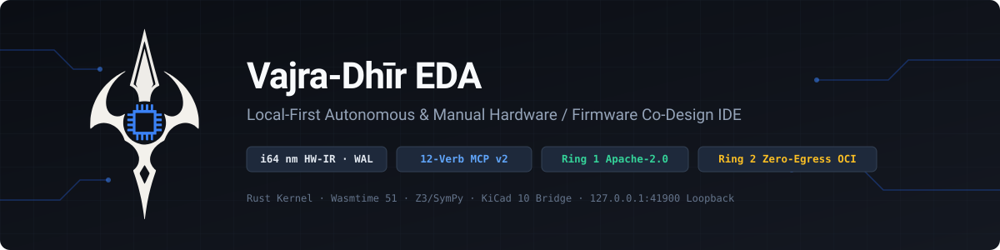
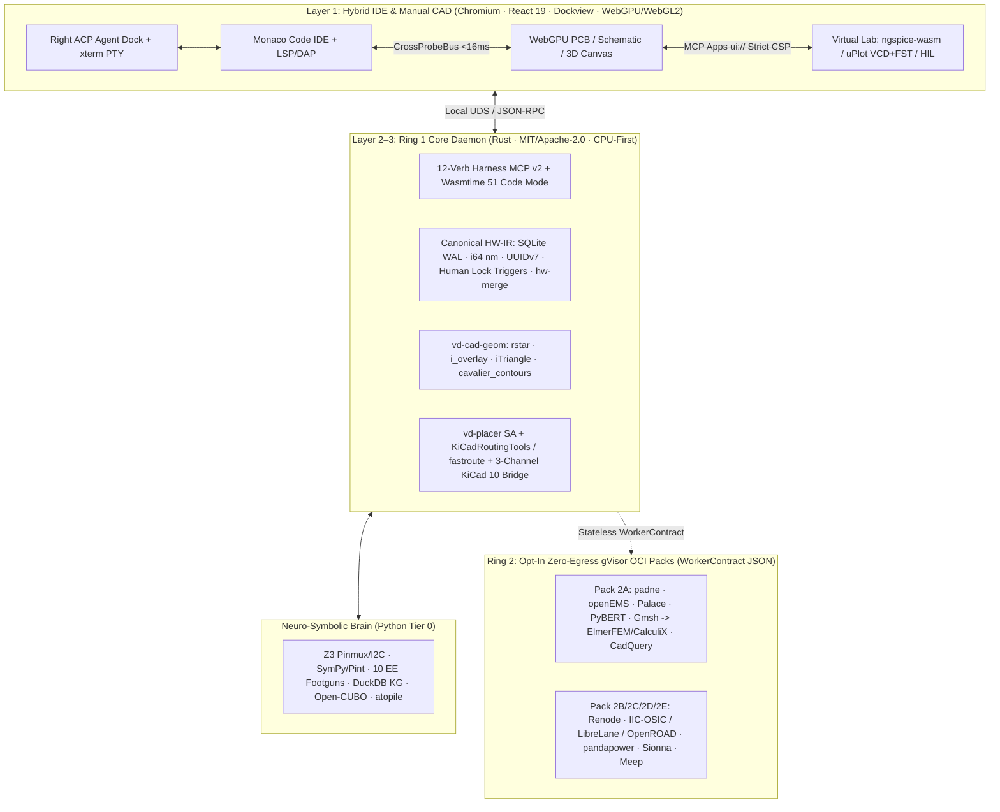

<p align="center">
  <picture>
    <source media="(prefers-color-scheme: dark)" srcset="assets/banner-dark.svg">
    <source media="(prefers-color-scheme: light)" srcset="assets/banner-light.svg">
    
  </picture>
</p>

<p align="center">
  <a href="https://github.com/Dev-Solanki-09/Vajra-Dhir-EDA/actions/workflows/ci-spec-integrity.yml">
    
  </a>
  <a href="LICENSE"></a>
  <a href="docs/ARCHITECTURE.md"></a>
  <a href="#project-status--radical-transparency"></a>
  <a href="CONTRIBUTING.md"></a>
</p>

---

**Vajra-Dhīr EDA** is an open-source **Hardware + Software Co-Design IDE** combining deterministic physics verification, craftsman-grade manual CAD, a VS Code + Claude Code hybrid coding environment, and fail-closed AI engineering agents—built from first principles to run **CPU-first on standard laptops** with strict permissive license isolation.

> **Engineering Principle:** *LLMs author architectural intent and structured repairs; deterministic compilers, formal SMT solvers (`Z3`), symbolic physics (`SymPy`/`Pint`), and isolated simulation/EM/FEM engines own math, geometry, and signoff. Never let a model grade its own circuit.*

---

## 30-Second Portable Quick Start (Zero Global Installs Required)

```bash
# Windows (double-click launch.bat, silent Vajra-Dhir-EDA.vbs, or run in terminal)
launch.bat

# Optional: create OS desktop & Start Menu shortcut
node scripts/create-shortcut.mjs

# macOS (double-click launch.command) / Linux
./launch.sh

# Self-contained Portable USB / Directory mode (all packs, DBs, py312 venv & cache stay in ./.vd-portable/)
pnpm start:portable   # or create an empty ./portable.flag file

# Strict Airgap / Offline launch (skips network pack checks completely)
node scripts/launch.mjs --offline
```

`launch.mjs` isolates Python 3.12 (`uv venv` under `.vd-runtime/py312/` or `.vd-portable/py312/`), builds `apps/workstation/dist` only if missing, binds cleanly to `127.0.0.1:41900–41950` with per-session token protection, and opens a distraction-free Chromium `--app` window (with OS default browser fallback). For container deployment strictly on loopback `127.0.0.1:41900`, run `docker compose -f docker/docker-compose.portable.yml up`.

---

## Project Status & Radical Transparency

We publish our complete, frozen industrial architecture and executable contracts **openly from Day 0** so hardware engineers, Rust/EDA developers, and researchers can review, critique, and co-build Milestone 1 together.

| Layer | Current Status | Verifiable Artifacts in This Repo |
|---|---|---|
| **Architecture Overview (`v0.0.5`)** | **Architecture Frozen · Milestone 1 Build (`Ring 1 / Ring 2`)** | [`docs/ARCHITECTURE.md`](docs/ARCHITECTURE.md) |
| **Canonical `HW-IR` Schema** | **Schema-Verified (`SQLite WAL`)** | [`packages/hw-ir/schema/001_init.sql`](packages/hw-ir/schema/001_init.sql), [`packages/hw-ir/schema/002_manual_perfection.sql`](packages/hw-ir/schema/002_manual_perfection.sql) |
| **Protocols & Security Model** | **Schema-Validated** | [`schemas/mcp-v2-12verbs.json`](schemas/mcp-v2-12verbs.json), [`schemas/worker_contract.v1.json`](schemas/worker_contract.v1.json), [`schemas/hw-plugin.v1.json`](schemas/hw-plugin.v1.json), [`docs/THREAT_MODEL.md`](docs/THREAT_MODEL.md) |
| **Release Readiness (`v0.0.5`)** | **Software Reference Blueprints (0/3 Physically Fabricated · Human Signoff Pending)** | [`docs/RELEASE_NOTES.md`](docs/RELEASE_NOTES.md), [`docs/VERIFICATION.md`](docs/VERIFICATION.md), [`docs/CLAIMS_REGISTER.md`](docs/CLAIMS_REGISTER.md) |
| **License & Acknowledgments** | **Apache-2.0 (+ Permissive Ring 1 Crates)** | [`LICENSE`](LICENSE), [`NOTICE`](NOTICE), [`docs/ACKNOWLEDGMENTS.md`](docs/ACKNOWLEDGMENTS.md), [`docs/LICENSE_EXCEPTIONS.md`](docs/LICENSE_EXCEPTIONS.md) |

---

## Why Build This? (The 5 Structural Failures in Current AI Hardware Tools)

1. **Silent Datasheet Hallucinations:** LLMs blur pinouts across IC variants and ignore MLCC DC-bias collapse or silicon errata.  
   → **Vajra-Dhīr Fix:** Zero-trust local `datasheet-lens` PDF cropper (SHA-256 + 300-dpi bounding boxes) verified by a **Dual-Context Isolated Auditor** (`Square-Harness` pattern) plus a DuckDB non-linear Component Knowledge Graph.
2. **Broken Manual + AI Co-Editing:** Auto-routers and AI edits silently overwrite human placement and copper pours.  
   → **Vajra-Dhīr Fix:** One canonical SQLite WAL `HW-IR` (`i64` integer nanometers, immutable UUIDv7), kernel-level `KERNEL_LOCK_VIOLATION` SQLite triggers protecting `locked=1` human edits, and a UUID 3-way Git merge driver (`hw-merge`) with rotated-courtyard collision detection.
3. **Hardware–Firmware Disconnect:** Swapping a GPIO pin to untangle PCB routing silently breaks embedded firmware.  
   → **Vajra-Dhīr Fix:** Bidirectional pin-to-firmware co-sync (`board_pins.h` / Zephyr `.dts` / Rust `embassy` HAL) compiled and verified inside `Renode` + `ngspice` before fabrication, inside one hybrid Monaco + ACP (`vd-agent` / Claude Code / Codex / Ollama) IDE.
4. **Heavy GPU / Cloud Lock-In & License Traps:** Proprietary SaaS tools lock up NDA IP.
   → **Vajra-Dhīr Fix:** **Ring 1** runs locally on CPU-only laptops (WebGPU with automatic WebGL2 fallback, zero Docker required, pure Apache-2.0); `NDA_AIRGAPPED` hard-blocks all outbound egress; GPLv2/v3 solvers run strictly inside zero-egress `gVisor` OCI containers.
5. **Toy Manual Editors:** Engineers refuse tools that can't handle real layout craft.  
   → **Vajra-Dhīr Fix:** Pure-MIT Rust/WASM 120 FPS geometry kernel (`rstar`, `i_overlay`, `iTriangle`, `cavalier_contours`, `manifold-csg`) + 3-Channel KiCad 10 bridge (`.kicad_sch` S-expr + optional live NNG IPC + headless `kicad-cli`).

---

## System Architecture at a Glance



### The 9-Gate Fail-Closed Pipeline
`G1 Spec Lock` → `G2 Open-CUBO + Z3/SymPy/Footguns` → `G3 Isolated Datasheet Auditor` → `G4 Virtual Lab & Firmware Twin` → `G5 Multi-Candidate Place & Route (Pareto)` → `G6 Multi-Physics Signoff Loop` → `G7 Deep DFM/DFA/IPC-2221/MCAD/DFT` → **`G8 Mandatory Human Cryptographic Release Signoff`** → `G9 Post-Silicon Bench HIL & Offline Harness²`

## Repository Map

```text
vajra-dhir-eda/
├── docs/                                   # Architecture, Security, Verification, Offline User Guides & FAQ
├── assets/                                 # Dark/Light Banners & Multi-OS App Icons (.svg/.ico/.icns/.png)
├── schemas/                                # MCP v2 12-verb, WorkerContract & Plugin JSON Schemas
├── packages/
│   ├── hw-ir/                              # Canonical SQLite WAL Kernel, UUIDv7, i64 nm, Lock Triggers
│   ├── hw-merge/                           # 3-Way Semantic Merge Driver for *.vd-ir.jsonl
│   ├── hw-dlp/                             # DLP Firewall, Secret Sanitizer, NDA Airgap Broker
│   ├── wasm-sandbox/                       # Wasmtime 51 Component Model Sandbox (Code Mode)
│   ├── cad-geom/                           # High-precision R-Tree spatial index & differential pairs
│   ├── placement-router/                   # Multi-threaded Rayon Simulated Annealing Placer
│   ├── cad-transcoder/                     # KiCad 10 3-Channel IPC Bridge & 5s Echo Suppression
│   ├── crossprobe-bus/                     # Sub-millisecond CrossProbeBus (IPC & UI)
│   ├── mcp-gateway/                        # Harness MCP v2 Gateway (12 Typed EDA Verbs)
│   ├── component-kg/                       # MLCC DC-Bias Derating, Inductor Saturation & Datasheet KG
│   ├── open-cubo/                          # Parametric Block Synthesizer (Buck, LDO, USB-PD, ESD)
│   ├── symbolic-verifier/                  # 10 EE Footguns & Symbolic Pinmux Constraint Solver
│   ├── nine-gates/                         # Fail-Closed 9-Gate Hardware Signoff State Machine
│   ├── eco-engine/                         # Geographical RefDes Re-Annotation & Staging Tray ECO
│   ├── sim-compat/                         # Vendor SPICE Compat, AST Transpiler & Encrypted Model Shield
│   ├── cam-pnp/                            # IPC-7525B Stencil Aperture DFM & Pick-and-Place Feeder Opt
│   ├── pdn-solver/                         # 2.5D DC Power Integrity, IR-Drop & IPC-2152 Thermal PDN Solver
│   ├── pcb-diff/                           # Pure-MIT Visual Layer-by-Layer PCB Diff & ECO Visualizer
│   ├── wire-harness/                       # Pure-MIT Declarative Cable & Wire Harness Compiler
│   ├── panelizer/                          # Pure-MIT Automated PCB Panelization & Perforation Generator
│   ├── constraint-mgr/                     # Netclass Width/Clearance, Diff-Pair Skew & Delay Bounds (`i64` nm)
│   ├── bom-analytics/                      # Assembly Variants (DNP), Extended Feeder Fee & Risk Scorer
│   ├── silicon-pack/                       # LibreLane Pack-2C Contract & C2P2B Ball Coordinate Bridge
│   ├── collab/                             # Yjs CRDT Projection w/ Fail-Closed Peer Locks & `hw.lock` Digest
│   ├── vd-daemon/                          # Local Loopback Daemon (127.0.0.1:41900), Live MCP v2 & ACP Broker
│   ├── worker-sdk/                         # Ring 2 Stateless WorkerContract Interface & Runner
│   ├── cli/                                # Unified `vd` Developer Command Line Tool
│   └── ui-apps/                            # Portable MCP UI (Waveform & Interactive Lenses)
├── apps/
│   ├── workstation/                        # Canonical Silicon Darkroom Studio (`vd studio`, React 19, Dockview MIT, WebGL2/Canvas2D, tracespace, elkjs, uPlot, Pure-MIT VCD)
│   └── desktop/                            # Compatibility Desktop Package Target (React 19, Dockview)
├── scripts/                                # 83-Gate Classified Verification & Playwright E2E Harnesses
└── .github/workflows/                      # Automated DDL, Schema, DCO & License Firewall CI
```

### Quick Verification Commands (100% Offline, $0 API Cost)

```bash
# 1. Dependency lock & SPDX license firewall
node scripts/check-spdx-firewall.mjs
cargo metadata --locked --format-version 1 > /dev/null

# 2. Full 83-gate verification harness & headless Chromium Golden E2E journeys
node scripts/verify-all.mjs
python scripts/test-g6d-e2e-golden-journeys.py

# 3. Quick start after cloning or downloading ZIP (installs deps, builds workstation UI, starts loopback daemon on 127.0.0.1:41900)
pnpm studio

# 4. Optional: sync external open-source upstream reference projects into vendor/ and workers/sources/
pnpm setup:projects
```

---

## Get Involved (Contributors & Reviewers Wanted)

We welcome **Rust systems engineers, mixed-signal PCB designers, KiCad/atopile power users, WebGPU/React graphics builders, and formal-verification/security researchers**:

- **Critique the Architecture:** Open an [Architecture RFC](../../issues/new?template=rfc_architecture.yml) or join [GitHub Discussions](../../discussions).
- **Contribute an Open-CUBO Block:** Propose a silicon-verified sub-circuit via an [Open-CUBO Proposal](../../issues/new?template=open_cubo_proposal.yml).
- **Pick a Milestone 1 Task:** Read [`CONTRIBUTING.md`](CONTRIBUTING.md) (all commits require DCO `git commit -s` — no CLA required).

---

## License & Isolation Policy

- **Repository License:** Apache License, Version 2.0 (see [`LICENSE`](LICENSE) and [`NOTICE`](NOTICE)).
- **Ring 2 External Engines:** GPLv2/GPLv3 tools (`KiCad`, `openEMS`, `ElmerFEM`, `CalculiX`, `IIC-OSIC-TOOLS`, etc.) execute strictly as isolated OS processes or OCI/`gVisor` containers—never linked into Ring 1 permissive code. AGPL dependencies, `EUPL-1.2` `surfer` in Ring 1, and non-commercial ML checkpoints are strictly excluded from core.
